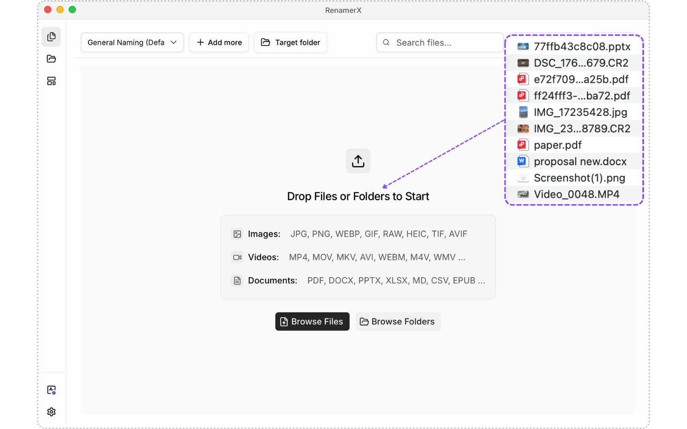
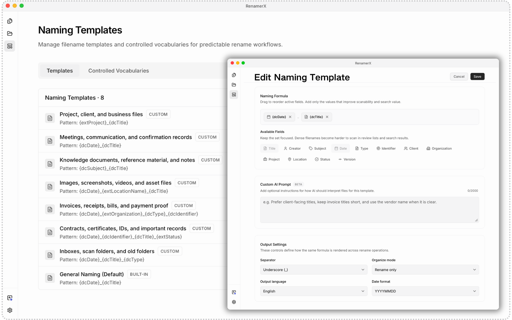
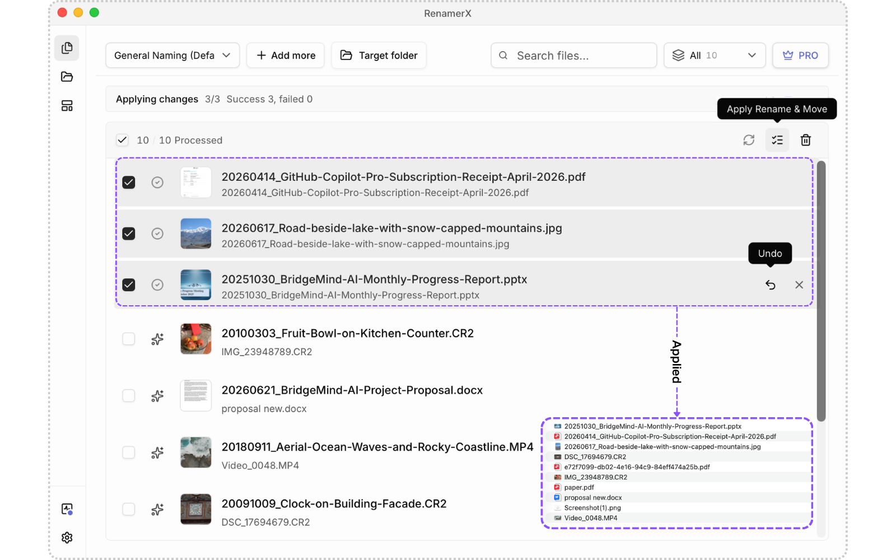
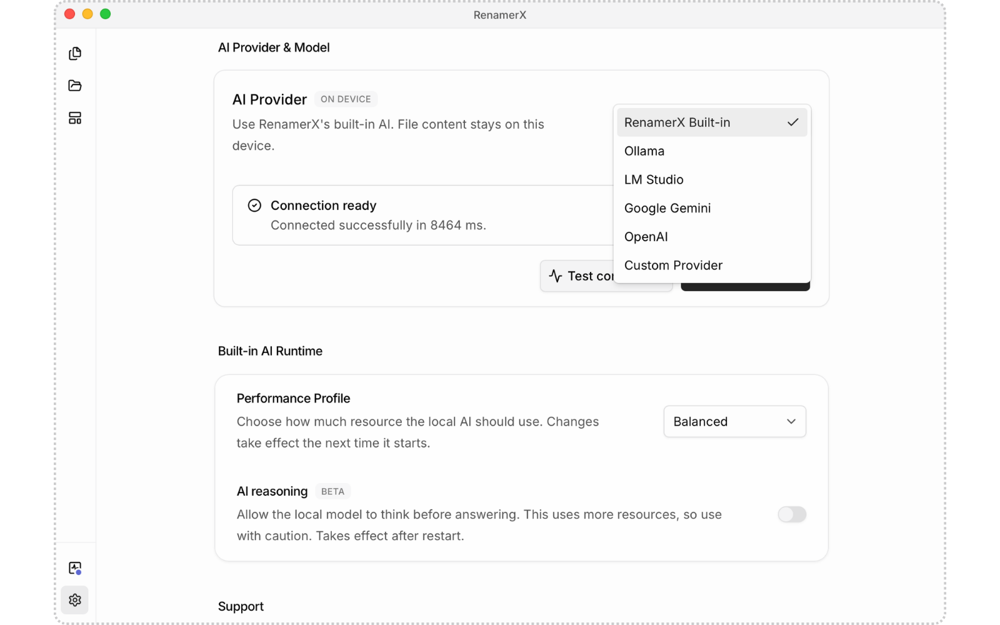
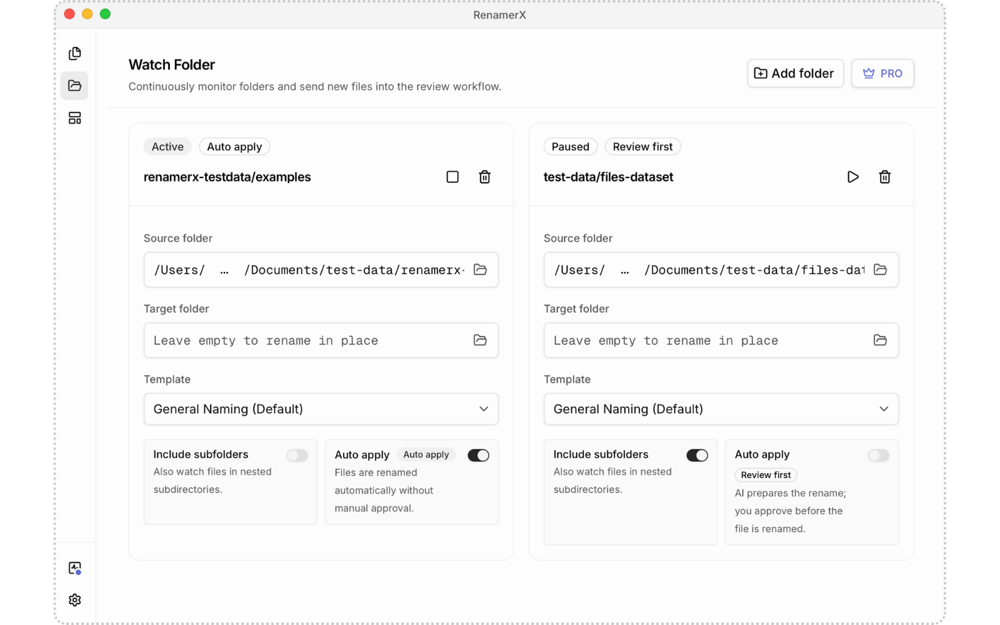

<p align="center">
  <a href="https://renamerx.com/">
    
  </a>
</p>

<p align="center">
  A local-first AI file renamer for macOS and Windows.
</p>

<p align="center">
  <a href="https://renamerx.com/"></a>
  <a href="CHANGELOG.md"></a>
  <a href="https://formulae.brew.sh/cask/renamerx"></a>
  <a href="https://apps.microsoft.com/detail/9N03KWP1XM0D"></a>
  
</p>

<p align="center">
  <a href="README.zh-CN.md">简体中文</a> ·
  <a href="https://renamerx.com/docs">Documentation</a> ·
  <a href="https://renamerx.com/privacy">Privacy</a> ·
  <a href="SUPPORT.md">Support</a>
</p>

> [!IMPORTANT]
> This repository hosts public documentation, naming-template examples, release notes, and issue tracking for RenamerX. The desktop application and its source code are proprietary and are not published in this repository. See [License and repository scope](#license-and-repository-scope).

RenamerX reads supported documents, images, and videos and turns names such as `scan001.pdf`, `IMG_4821.jpg`, or `final_v3.mov` into clear, searchable filenames that follow your naming convention. AI extracts structured fields; reusable templates determine the final format; you review the proposed changes before applying them and can undo supported operations afterward.



## Why RenamerX

- **Rename files by content.** Extract useful titles, dates, subjects, organizations, identifiers, locations, and media details from supported files.
- **Keep names consistent.** Templates control field order, separators, date formats, output language, controlled terms, and optional organization rules.
- **Review first.** Edit, ignore, or retry suggestions before RenamerX changes files on disk.
- **Undo applied changes.** Restore supported rename and organization operations when needed.
- **Use built-in local AI.** Analyze supported file content on your device without configuring a separate AI service or API key.
- **Choose another AI service when needed.** Advanced users can connect Ollama, LM Studio, OpenAI, Google Gemini, or a compatible endpoint. The selected service determines the data boundary.
- **Automate recurring folders carefully.** Watch Folders reuse a proven naming workflow; Auto Apply is intended for stable, trusted folders.

| Reusable naming templates | Review, apply, and undo |
| --- | --- |
|  |  |

| Built-in local AI | Watch Folder automation |
| --- | --- |
|  |  |

## Install RenamerX

### macOS

Install the signed and notarized universal app through Homebrew:

```bash
brew install --cask renamerx
```

You can also download the current macOS release from the [official website](https://renamerx.com/).

### Windows

Install and update RenamerX through the [Microsoft Store](https://apps.microsoft.com/detail/9N03KWP1XM0D).

See the [installation guide](https://renamerx.com/docs/getting-started/installation) for current system requirements, first-launch resource setup, and AI-provider options.

## How it works

1. Create or choose a naming template.
2. Add a small folder or a batch of supported files.
3. Let the selected AI service extract the fields required by the template.
4. Review the proposed From/To changes and edit any edge cases.
5. Apply the batch. Use Undo if you need to restore a supported operation.
6. After the workflow is proven, reuse it with a Watch Folder if appropriate.

Start with a small, non-critical folder. New templates and mixed folders should use the review-first workflow before any automation is enabled.

## Privacy boundaries

RenamerX is local-first, but the exact boundary depends on the AI service you select:

- **RenamerX Built-in:** supported file content used for naming inference stays on the device after required resources are installed.
- **Ollama, LM Studio, and Custom:** data is sent to the endpoint you configure; whether that endpoint is local or remote depends on your setup.
- **OpenAI and Google Gemini:** the content, previews, metadata, and naming settings required for analysis are sent to the selected cloud provider under its terms.
- **Operational services:** downloads, updates, licensing, purchases, website analytics, and diagnostics may use network services as described in the current policies.

Read [Privacy boundaries](docs/privacy-boundaries.md), the [Security and Privacy guide](https://renamerx.com/docs/help-support/security-and-privacy), and the [Privacy Policy](https://renamerx.com/privacy) before using RenamerX with sensitive material.

## Documentation and examples

- [Install and update RenamerX](docs/installation.md)
- [Understand privacy boundaries](docs/privacy-boundaries.md)
- [Troubleshooting](docs/troubleshooting.md)
- [Naming-template starting points](examples/naming-templates/README.md)
- [Official documentation](https://renamerx.com/docs)
- [Supported file types](https://renamerx.com/docs/getting-started/supported-file-types)
- [Release notes](CHANGELOG.md)

## Issues and feature requests

Use [GitHub Issues](https://github.com/sancijun/RenamerX/issues) for reproducible bugs and focused feature requests. Before posting:

- search existing issues;
- remove confidential filenames, paths, document contents, API keys, license keys, and personal information;
- include the RenamerX version, operating system, installation method, and selected AI provider;
- do not upload private customer files or unredacted diagnostic archives.

For account, purchase, license, or private support matters, email [support@renamerx.com](mailto:support@renamerx.com). Security vulnerabilities must be reported privately according to [SECURITY.md](SECURITY.md).

## Contributing

Documentation corrections and useful naming-template examples are welcome. This repository does not accept application-source contributions because the desktop application is not open source. Read [CONTRIBUTING.md](CONTRIBUTING.md) before opening a pull request.

## License and repository scope

The documentation and example content published in this repository are available under the MIT License, subject to the scope described in [LICENSE](LICENSE).

The RenamerX desktop application, application source code, downloadable binaries, product branding, logo, and trademarks are proprietary and are **not** licensed under the repository's MIT License. All rights not expressly granted are reserved.
