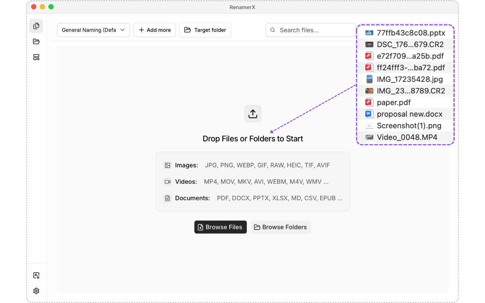
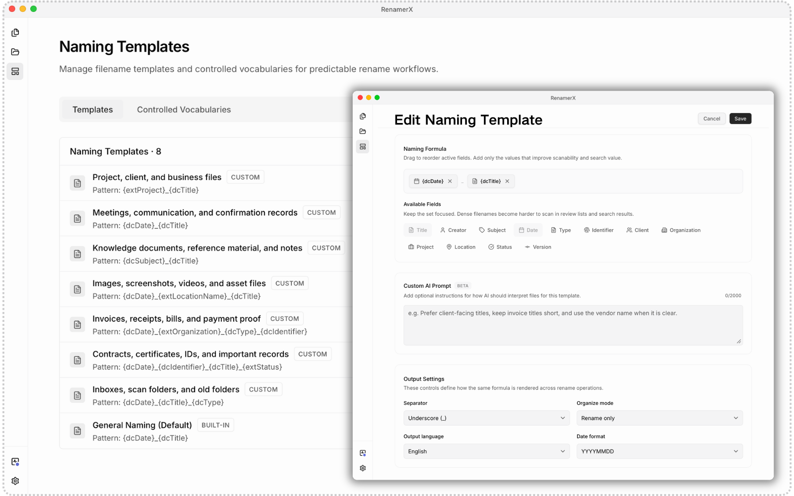
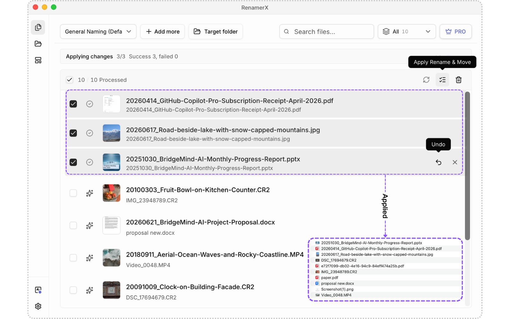

  

  面向 macOS 和 Windows 的本地优先 AI 文件重命名工具。

  <a href="README.md">English</a> ·
  <a href="https://renamerx.com/zh/docs">使用文档</a> ·
  <a href="https://renamerx.com/zh/privacy">隐私政策</a> ·
  <a href="SUPPORT.md">支持</a>

> [!IMPORTANT]
> 本仓库用于发布 RenamerX 的公共文档、命名模板示例、版本说明和问题反馈。桌面应用及其源代码属于专有软件，不在本仓库中公开。许可边界见[许可证与仓库范围](#许可证与仓库范围)。

RenamerX 读取支持的文档、图片和视频，将 `scan001.pdf`、`IMG_4821.jpg`、`final_v3.mov` 这类看不懂的文件名转换为遵循你命名规范的清晰、可搜索文件名。AI 提取结构化字段，命名模板决定最终格式；你可以在应用前审阅和编辑建议，并在应用后撤销支持的操作。

## 核心能力

- **按内容重命名：**从支持的文件中提取标题、日期、主题、组织、编号、地点和媒体信息。
- **使用命名模板保持一致：**控制字段顺序、分隔符、日期格式、输出语言、受控词表和目录组织规则。
- **先审阅再应用：**在真正修改磁盘文件前编辑、忽略或重试建议。
- **应用后可撤销：**需要时恢复支持的重命名和目录组织操作。
- **内置本地 AI：**无需单独配置 AI 服务或 API Key，即可在设备上分析支持的文件内容。
- **可选其他 AI 服务：**高级用户可连接 Ollama、LM Studio、OpenAI、Google Gemini 或兼容接口；所选服务决定实际数据边界。
- **谨慎自动化重复目录：**监控文件夹复用已经验证的命名流程，Auto Apply 只适合稳定、可信的目录。

| 可复用命名模板 | 审阅、应用和撤销 |
| --- | --- |
|  |  |

## 安装

### macOS

从 [RenamerX 官网](https://renamerx.com/zh/)下载当前 macOS 版本。

### Windows

通过 [Microsoft Store](https://apps.microsoft.com/detail/9N03KWP1XM0D) 安装和更新 RenamerX。

当前系统要求、首次启动资源下载和 AI 服务选择请查看[安装指南](https://renamerx.com/zh/docs/getting-started/installation)。

## 工作流程

1. 创建或选择命名模板。
2. 添加一个小目录或一批支持的文件。
3. 让所选 AI 服务提取模板需要的字段。
4. 审阅 From/To 修改，编辑需要调整的边缘情况。
5. 应用批次；需要恢复时使用 Undo。
6. 流程经过验证后，再按需用于监控文件夹。

新模板和混合文件夹应先在非关键的小目录中使用“先审阅”流程，不要直接启用自动应用。

## 隐私边界

- **RenamerX Built-in：**所需资源安装完成后，用于命名推理的支持文件内容留在设备上。
- **Ollama、LM Studio 和 Custom：**数据会发送到你配置的接口；该接口位于本地还是远程取决于你的设置。
- **OpenAI 和 Google Gemini：**分析所需的内容、预览、元数据和命名设置会发送给所选云服务，并适用该服务的条款。
- **运营服务：**下载、更新、许可证、购买、网站分析和诊断可能使用网络服务，具体以当前政策为准。

处理敏感材料前，请阅读[隐私边界说明](docs/privacy-boundaries.md)、[安全与隐私文档](https://renamerx.com/zh/docs/help-support/security-and-privacy)和[隐私政策](https://renamerx.com/zh/privacy)。

## 问题反馈

可通过 [GitHub Issues](https://github.com/sancijun/RenamerX/issues) 提交可复现的 Bug 和明确的功能建议。公开内容前请删除机密文件名、路径、文档内容、API Key、许可证密钥和个人信息，不要上传客户文件或未脱敏的诊断包。

账户、购买、许可证或需要包含隐私信息的支持请求，请发送邮件至 [support@renamerx.com](mailto:support@renamerx.com)。安全漏洞必须按照 [SECURITY.md](SECURITY.md) 私下报告。

## 许可证与仓库范围

本仓库发布的文档和示例内容按照 [LICENSE](LICENSE) 中限定的范围使用 MIT License。

RenamerX 桌面应用、应用源代码、可下载二进制文件、品牌素材、Logo 和商标属于专有内容，**不适用**本仓库的 MIT License。未明确授予的权利均予保留。
